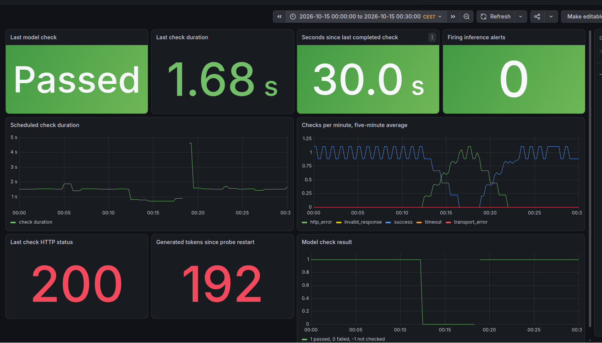

# Ollama inference monitoring verification

Status: observed checks passed.

Exercise completed: 2026-10-15, Europe/Prague. The UTC timeline below falls on
2026-10-14. Sources are the operator's terminal observations and the
referenced captures in this directory.

Operator: David Benito Campo, workstation `badbeny@F42Prague`.

Deployed Git revision:
`main@sha1:5f09c2c6e7b40f1669c8b00385c69a63c666d2d2`.
The denial Job correction was a local working-tree change during this exercise.

Topology and access: one `pi-lab` node, namespace `ai-lab`, Kubernetes API
access through the existing SSH tunnel and VPN kubeconfig, and Prometheus
through workstation port-forward `127.0.0.1:19190`.

Ollama API version: `0.40.0`. Model: `qwen2.5:0.5b`.

Probe configuration: one request per 60 seconds, a 15-second socket timeout,
and up to 16 generated tokens. Prometheus scrapes and evaluates rules every
30 seconds. `OllamaInferenceCheckFailing` has a 120-second hold.

## Procedure

1. Capture successful model requests and the Prometheus success metric.
2. Check `/api/version` from the approved probe Pod.
3. Run the corrected unapproved-client Job, then check approved access again.
4. Follow the runbook's missing-model exercise and capture pending and firing
   alert states.
5. Resume and reconcile the probe's Flux Kustomization.
6. Verify model requests, scrape health, and final alert states.

The [failure log](ollama-inference-alert-failures.jsonl) confirms
`lab-missing-model:never-pulled` returned `http_error` with HTTP 404 at
2026-10-14T22:12:11.756694Z. The failed request generated zero tokens.

## Observed results

| Check | Observed result | Evidence |
| --- | --- | --- |
| Model baseline | Ten successful HTTP 200 requests, each generating 16 tokens | [Probe log](ollama-inference-monitoring-baseline.jsonl) |
| Baseline duration | 1.426 to 1.877 seconds across these ten requests | [Probe log](ollama-inference-monitoring-baseline.jsonl) |
| Baseline metric | `ollama_probe_success` returned 1 | [Baseline query](ollama-inference-monitoring-baseline.json) |
| Approved access before denial | HTTP 200, Ollama version 0.40.0 | Operator terminal output, no separate before-file captured |
| Unapproved access | DNS resolved, request returned `ConnectionRefusedError(111, 'Connection refused')`, and Job reached `Complete` | [Denied-client log](ollama-inference-network-denied.txt) |
| Approved access after denial | HTTP 200, Ollama version 0.40.0 | [Approved-client output](ollama-inference-network-approved-after.txt) |
| Missing-model failure | `http_error`, HTTP 404, zero generated tokens | [Failure log](ollama-inference-alert-failures.jsonl) |
| Inference alert | Pending, then firing with a probe success value of 0 | [Pending](ollama-inference-alert-pending.json), [firing](ollama-inference-alert-firing.json) |
| Model recovery | HTTP 200, `qwen2.5:0.5b`, 16 generated tokens | [Recovery log](ollama-inference-alert-recovered.jsonl) |
| Flux recovery | `SUSPENDED=False`, `READY=True`, expected Git revision applied | Operator terminal output |
| Scrape recovery | `up=1`, target health `up`, empty `lastError` | Operator query and target API output |
| Final inference metric | `ollama_probe_success=1` | [Recovery query](ollama-inference-monitoring-recovered.json) |
| Final alerts | All three Ollama alerts inactive with empty active-alert lists | [Recovery rules](ollama-inference-alert-recovered.json) |

## Timeline

All timestamps are UTC on 2026-10-14. Evaluation timestamps identify observed
states. They do not establish the exact time of every transition.

| Event | Observed UTC time | Evidence |
| --- | --- | --- |
| First of ten captured baseline successes | 22:00:39.672185 | Baseline probe log |
| Last of ten captured baseline successes | 22:09:39.675667 | Baseline probe log |
| Missing-model HTTP 404 recorded | 22:12:11.756694 | Failure probe log |
| Model-failure alert entered pending | 22:12:52.964264 | Alert `activeAt` |
| Firing confirmed by evaluation | 22:14:52.965997 | Firing rule snapshot |
| First captured successful request after Git recovery | 22:18:32.923609 | Recovery probe log |
| Probe-unavailable alert entered pending during recovery | 22:18:52.964264 | Pending recovery snapshot |
| Successful scrape confirmed | 22:21:59.894473 | Target API `lastScrape`, health `up`, empty error |
| All Ollama alerts confirmed inactive | 22:25:52.966660 | Final rules snapshot |

## Correction and interpretation

The original denial Job accepted only a timeout. The observed unapproved
connection returned a refusal, so the original Job exited with code 1 and
reported `BackoffLimitExceeded`.

The corrected Job accepts timeout or connection refusal, including wrapped
`urllib.error.URLError` cases. DNS failures, unexpected network errors, and
HTTP 200 and HTTP 404 responses still fail the check. The runbook requires
successful requests from the approved client immediately before and after
the denied run.

The paired client checks support the intended access restriction for these
tested clients and this Service path. A refusal or a completed Job on its own
does not establish policy enforcement.

During recovery, a successful model request and an inactive inference-failure
alert preceded confirmed scrape recovery. The probe-unavailable alert was
pending in the earlier recovery snapshot. Keep
[the pending snapshot](ollama-inference-alert-recovery-pending.json) alongside
the final healthy state. The recorded samples do not establish the
interruption's exact duration or cause.

## Follow-up dashboard and resource captures

The operator supplied two dashboard screenshots on 15 October 2026.
The historical view selects Europe/Prague, from 2026-10-15 00:00 to 00:30.
This corresponds to 2026-10-14 22:00 to 22:30 UTC. Its model-check result
drops to 0 during failed checks and returns to 1 after recovery.

The [separate current view](2026-10-15-ollama-inference-dashboard-current.png)
uses the relative range `Last 1 hour` and shows a passed model check, a
1.62-second last check, and zero firing inference alerts.

Both screenshots show the dashboard before the panel color correction.
The HTTP 200 value and generated-token count appear red because those panels
used default numeric coloring.

The later resource capture started at 2026-10-15 20:36:56 UTC,
or 22:36:56 Europe/Prague. The operator ran `date -u`, then
`kubectl top pods -n ai-lab --containers`. These readings describe
normal operation after the earlier alert exercise.

| Pod | Container | CPU | Memory |
| --- | --- | --- | --- |
| `ollama-76f6f79d6-zxmpt` | `ollama` | 1m | 678 MiB |
| `ollama-inference-probe-5fb86f7749-fdcqx` | `probe` | 1m | 56 MiB |

[Operator-supplied resource output](2026-10-15-inference-resources.txt).
Here, 1m CPU means 0.001 CPU cores. The timestamp marks the start of the
capture sequence. The output does not include the metrics sample timestamps.

## Measurement limits

One recorded exercise was completed. The sample of ten scheduled requests
does not establish an uptime SLO or a sustained-load benchmark.

The exact fault-injection and recovery-command timestamps were not captured.
End-to-end detection delay and recovery duration were not measured. The
observed pending-to-firing interval agrees with the configured 120-second hold.

OS/kernel, K3s/Flux versions, deployed Ollama/probe image digests, clock
synchronization, power, and notification delivery were not measured in this
run. The later CPU and memory capture is one normal-operation snapshot.
Peak usage and resource usage during the failure exercise were not measured.

## Related procedure

[Inference monitoring runbook](../runbooks/inference-monitoring.md)
